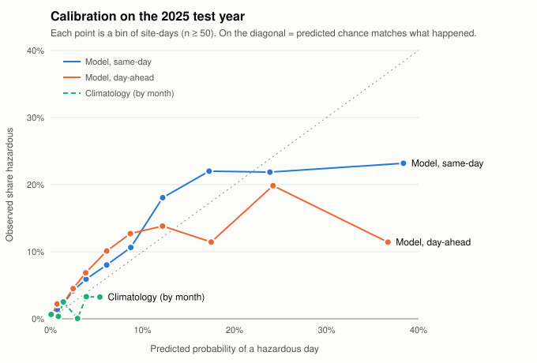

# The ML hazard index

Code: `backend/ml/` (model), `backend/hazards/risk.py` + `backend/hazards/model_scores.py` (live) · Tests: `backend/tests/test_ml.py`, `backend/tests/test_hybrid.py` · Model: `backend/ml/models/`

## In one paragraph

For each site and day, a LightGBM model estimates **the chance that NOAA logs a crew-relevant hazardous-weather event at the site that day**: a thunderstorm-wind, hail, tornado, lightning, flood, heavy-rain, coastal-flood, heat, wildfire, or tropical event within 15 miles or in the site's NWS zone. It reads the same kind of weather forecast it will see live (Open-Meteo, HRRR model), turns the probability into a **0–10 hazard index**, and lists the **top 3 reasons** in plain language ("2.2 in of rain forecast", "Heat index 111°F"). On 2025, a year it never saw:

- It ranks risky days **3–4× better than both baselines** (PR-AUC 0.128 vs 0.032 for monthly climatology and 0.040 for a rain/heat-index rule). The 95% confidence intervals for the improvement exclude zero.
- **Red days (index ≥ 7)** were 8% of site-days, and **1 in 7 of them** had a logged hazardous event, against **1 in 170 green days**. Red days held 44% of all events.
- It works a day ahead too, with somewhat less skill (PR-AUC 0.102 tomorrow vs 0.128 today).

It's a decent first model, not a finished one: it can't learn heat or wildfire well from these labels, and it leans partly on *where* NOAA tends to receive reports. Details are in [Limitations](#honest-limitations). That's why the index in the app is a **hybrid**: the model's weather score or a safety rule (OSHA heat band, wildfire, wildlife, crew reports), whichever is higher, plus the lightning stop-work override. See [section 8](#8-live-the-hybrid-hazard-index).

## 1. Labels: what counts as a hazardous day

**Source:** NOAA/NCEI Storm Events Database, bulk "details" CSVs for 2018–2025 (newest revision of each year, downloaded by `python -m ml.labels`). We keep Florida rows of these event types, grouped into four sub-labels:

| Sub-label | Storm Events types |
|---|---|
| storm | Thunderstorm Wind, Lightning, Hail, Tornado, Tropical Storm, Hurricane (Typhoon) |
| flood | Flash Flood, Flood, Heavy Rain, Coastal Flood |
| heat | Heat, Excessive Heat, Extreme Heat (the 2025 rename) |
| fire | Wildfire |

**Matching an event to a site** (`ml/labels.py`):

- **Point/path events** (county-type rows with coordinates: wind, hail, tornado, lightning, floods, heavy rain). The event's begin→end segment must pass within **15 miles** of the site. We measure the distance to the closest point on the path, so a tornado track that passes nearby counts even if it starts and ends farther away.
- **Zone events** (heat, tropical, coastal flood, wildfire). The event's NWS zone must be the site's current forecast or fire-weather zone, *or* the zone's name must contain the site's county. Zones come from `api.weather.gov/points` once per site (cached). The county-name rule is needed because Florida zones were **renumbered during 2018–2025**: Brevard 47 became 247/347/447/547/647/747 in 2022 and Duval 25 became 325/425 in 2023, and NOAA's own data has typos like "PUTNUM". Matching on today's zone IDs alone would silently miss the older events.
- **Dates.** Storm Events times are in local *standard* time (`CZ_TIMEZONE` = EST-5 / CST-6). We convert to UTC, then to the site's own timezone, and take that local date. A multi-day event (a tropical storm, a river flood) labels every day it covers.

**Base rate: 2.48% of site-days** across 2018–2025 (3,991 of 160,710). By year:

| Year | Any | Storm | Flood | Heat | Fire |
|---|---|---|---|---|---|
| 2018 | 1.89% | 1.52% | 0.38% | 0.00% | 0.04% |
| 2019 | 2.09% | 1.40% | 0.58% | 0.00% | 0.19% |
| 2020 | 3.08% | 1.86% | 1.19% | 0.00% | 0.21% |
| 2021 | 1.94% | 1.06% | 0.92% | 0.00% | 0.06% |
| 2022 | 2.97% | 2.29% | 0.91% | 0.06% | 0.00% |
| 2023 | 2.77% | 1.67% | 0.93% | 0.26% | 0.05% |
| 2024 | 2.76% | 2.06% | 0.91% | 0.00% | 0.04% |
| 2025 | 2.37% | 1.03% | 0.86% | 0.00% | 0.59% |

Two things in this table shape everything after it:

- **Heat is almost never logged for Florida.** Storm Events has Florida heat entries only in 2022 (9) and 2023 (216). There are none in record-hot 2024, and no "Extreme Heat" after the 2025 rename. So validation and test have zero heat labels.
- **2025 is unusual.** It had no tropical landfalls, fewer thunderstorm-wind reports than any other year (268, against 308–713), and a drought-driven wildfire season. Fire days jump 15×.

## 2. Features: what the model reads

All weather comes from **Open-Meteo, model `gfs_seamless`**, which over Florida is NOAA's 3-km HRRR for the first ~48 h. Training and live scoring use the same model, variables, units (°F, inches, mph), and code (`ml/features.py`). Each site-day is computed on the site's local calendar date.

| Feature | Meaning |
|---|---|
| `tmax_f` | Daily high temperature |
| `heat_index_max_f` | Highest hourly NWS heat index (Rothfusz regression with NWS adjustments; matches the NWS table within 0.4°F) |
| `rain_in`, `rain_rate_max_in` | Rain that day; wettest single hour |
| `rain_prior3_in`, `rain_prior7_in` | Rain over the 3 and 7 days *before* the day |
| `gust_max_mph` | Strongest wind gust |
| `cape_max` | Peak CAPE (convective energy; the fuel for thunderstorms) |
| `thunder_hours` | Hours with a thunderstorm weather code |
| `soil_moisture_pct` | Mean 0–10 cm soil moisture |
| `doy_sin`, `doy_cos` | Day of year on a circle (Dec 31 sits next to Jan 1) |
| `lat`, `lon` | Site location |

FEMA flood zone isn't stored for sites in this repo yet, so it isn't a feature.

### Archived forecasts, not reanalysis

You asked to train on archived forecasts if coverage allowed, and it does. Checking Open-Meteo's **Historical Forecast API** year by year showed:

- `gfs_seamless` (HRRR) has temperature, humidity, rain, gusts, CAPE, and weather code from **2018**. At our test point its values are identical to `best_match` and clearly different from ERA5 reanalysis (July 2018 rain: 15.2 in HRRR vs 9.8 in ERA5), so it really is forecast output.
- GFS **soil moisture starts in 2022**. ECMWF data only starts in 2024.
- The **Previous Runs API** has the forecast issued ~24 h earlier (`_previous_day1`) for every hour of 2025, so the "tomorrow" index can be tested on real day-ahead forecasts.

So the model trains on archived forecasts: it learns from the same kind of input, with the same biases, that it gets live. We didn't need the reanalysis fallback.

## 3. Split by time

| | Years | Site-days | Hazardous |
|---|---|---|---|
| Train | 2022–2023 | 40,150 | 1,152 (2.87%) |
| Validation (calibration + index anchors) | 2024 | 20,130 | 555 (2.76%) |
| Test (touched once, at the end) | 2025 | 20,075 | 476 (2.37%) |

Nothing is shuffled across time. Hyperparameters were picked on an **inner split inside the training years** (fit 2022, score 2023), so 2024 and 2025 were never used for tuning.

**Why only two training years:** Open-Meteo's free tier is 10,000 calls/day per IP, and the live backend polls from the same machine. One site-year costs ~26 calls (55 sites × 8 years would be ~11.5k). We kept all 55 sites and dropped 2018–2021. A side benefit is that every training row has soil moisture. The downloader enforces its own rolling-24 h budget so it can't starve the live poller (see [Reproducing](#reproducing-it)).

## 4. The model

- **LightGBM**, binary objective, 7 leaves per tree, 904 trees at learning rate 0.03. The inner-split early-stopping round (452) is scaled up for twice the training data.
- **Monotone constraints.** More rain, wind, CAPE, heat, or soil moisture can only *raise* the risk. That rules out physically silly patterns learned from noise and keeps explanations sensible. On the inner split the monotone model was also the most accurate: 0.268 PR-AUC vs 0.261 unconstrained.
- **Class imbalance (~1 hazardous day in 35).** We tried up-weighting hazardous days 1×, 5.7× (√ratio), and 32.7× (full ratio). **No up-weighting scored best on the inner split**, and since probabilities are calibrated afterwards, weighting would only have reshaped the trees. Imbalance is handled by scoring with PR-AUC (which focuses on the rare class), early-stopping on it, and calibrating.
- **Calibration.** Platt scaling on 2024: `p = sigmoid(0.843 · logit(raw) − 0.590)`. Isotonic calibration was fit for comparison and scored the same on 2025 (Brier 0.02222 vs 0.02219), so we kept the simpler two-number version.

## 5. Results on 2025 (the test year)

Baselines:

- **Climatology.** The 2022–2023 hazardous rate for that calendar month (0.06% in February up to 5.4% in September).
- **Simple rule.** Flag the day if forecast rain ≥ 1 in *or* heat index ≥ 108°F. As a probability it's 13.5% when the rule fires and 1.9% when it doesn't, both from training data.

"Same-day" uses archived short-lead forecasts, which is what the 6 AM "today" index sees. "Day-ahead" uses the forecast issued ~24 h earlier, which is what the 6 PM briefing's "tomorrow" index sees.

| 2025, 476 hazardous of 20,075 site-days | PR-AUC ↑ | ROC-AUC ↑ | Brier ↓ | Log loss ↓ |
|---|---|---|---|---|
| **Model, same-day** | **0.128** | **0.842** | **0.02219** | **0.0948** |
| **Model, day-ahead** | **0.102** | **0.825** | 0.02271 | 0.0999 |
| Climatology by month | 0.032 | 0.615 | 0.02319 | 0.1125 |
| Rule (rain ≥ 1 in or HI ≥ 108°F), same-day | 0.040 | 0.599 | 0.02308 | 0.1091 |
| Rule, day-ahead | 0.034 | 0.564 | 0.02313 | 0.1106 |
| *(a coin flip would be)* | *0.024* | *0.500* | | |

**Does it beat both baselines? Yes for ranking, and a little for probability accuracy.** The confidence intervals come from resampling whole *dates*, because one storm hits many sites at once and site-days aren't independent:

| Model minus baseline, 2025 | PR-AUC gain (95% CI) | Brier change (95% CI) |
|---|---|---|
| Same-day vs climatology | +0.097 (+0.072 to +0.131) | −0.0010 (−0.0017 to −0.0003) ✔ |
| Same-day vs rule | +0.089 (+0.064 to +0.123) | −0.0009 (−0.0016 to −0.0002) ✔ |
| Day-ahead vs climatology | +0.070 (+0.051 to +0.099) | −0.0005 (−0.0011 to +0.0002) ✘ not significant |
| Day-ahead vs rule | +0.068 (+0.051 to +0.094) | −0.0004 (−0.0010 to +0.0002) ✘ not significant |

The ranking gain is large and certain. The Brier gain is small: a 4% Brier skill score over climatology same-day, and 2% (not significant) day-ahead. That's normal for a rare event where most days are near-zero either way, but it means **the probability itself is only modestly sharper than "it's August"**. The ordering of days and sites is where the model earns its keep.

**At a fixed alert budget.** The rule flags 7.9% of site-days and catches 27% of events, with 8.2% of its flags being hazardous days. If the model flags the same 7.9%, it catches **45%** of events at **13.4%** precision. That's 1.6× as many events from the same number of alerts.

### Calibration



| Predicted (same-day) | Site-days | Mean predicted | Observed |
|---|---|---|---|
| < 0.5% | 10,727 | 0.1% | 0.4% |
| 0.5–1% | 2,665 | 0.7% | 1.4% |
| 1–2% | 2,675 | 1.4% | 2.3% |
| 2–3% | 1,264 | 2.5% | 4.2% |
| 3–5% | 1,149 | 3.9% | 5.9% |
| 5–7.5% | 636 | 6.1% | 8.0% |
| 7.5–10% | 282 | 8.7% | 10.6% |
| 10–15% | 299 | 12.2% | 18.1% |
| 15–20% | 159 | 17.2% | 22.0% |
| 20–30% | 128 | 23.8% | 21.9% |
| 30–50% | 69 | 38.4% | 23.2% |
| ≥ 50% | 22 | 62.9% | 0.0% |

Up to about 20% the model tracks reality but runs slightly low. That under-prediction is almost entirely 2025's wildfire days: drop the 113 fire-only days and the mean prediction is 1.72% against 1.82% observed. Above 20% it is **over-confident**. Those very high probabilities were learned from 2024's hurricane days, and 2025 had none.

### Per hazard

The model predicts one combined probability. This table shows how well that probability ranks each kind of event, with other days counted as negatives:

| 2025, same-day | Events | PR-AUC (base rate) | ROC-AUC | Share that scored red |
|---|---|---|---|---|
| Storm | 207 | 0.082 (0.010) | 0.893 | 56% |
| Flood | 173 | 0.074 (0.009) | 0.899 | 60% |
| Fire | 118 | 0.009 (0.006) | 0.666 | 8% |
| Heat | 0 | — | — | — |

Storms and floods are where the skill is, about 8× better than chance at the top of the ranking. Fire is barely above chance; the features have no drought or fuel-dryness signal. Heat **can't be evaluated**: there are no heat labels in 2024 or 2025.

### Why validation looks so much better than test

Validation (2024) PR-AUC is 0.47, but test is 0.13. 2024 had Debby, Helene, and Milton: 207 of its 555 hazardous days were tropical-storm or hurricane days, which forecasts see coming and which hit many sites at once. Without those days, 2024's PR-AUC is 0.119, in line with 2025's 0.128. **Expect about 0.13 in an ordinary year and more in a hurricane year.**

### August 4, 2025 (our replay storm day)

Five sites had a logged event that day: tornadoes near the **Osceola** (11 mi) and **Stanton** (13 mi) plants, and a Palm Beach County wildfire covering the **West County**, **Riviera**, and **Okeelanta** zones.

- **Same-day forecast.** The model ranked Aug 4 as the **30th riskiest day of 2025** (top 8%) by mean index across sites. It had 12 sites red and 31 amber.
  - **Stanton was red at 7.2**: "Unstable air for storms (CAPE 4,640 J/kg)"; "2.2 in of rain forecast"; "Heat index 111°F".
  - **Osceola was 6.9**, just under red: "6.6 in of rain forecast"; "Unstable air for storms (CAPE 4,300 J/kg)"; "Extreme downpours forecast (3+ in/hr)".
  - The three wildfire sites were amber at 4.3, mostly on heat and CAPE. The model had no fire signal.
  - The highest scores were in the panhandle and Jacksonville area (J.D. Kennedy 8.2, Lansing Smith 7.9), where nothing was logged that day.
- **Day-ahead forecast.** The day still looked stormy (13 sites red), but the forecast issued on Aug 3 put the storms elsewhere. Stanton scored 4.1 and Osceola 3.1. That's typical: day-ahead models get the *day* right more often than the *exact place* for summer thunderstorms.

Storm Events only logs lightning when it causes damage or injury. So on a day picked for its *lightning*, the five labels understate how hazardous it was for crews. The live lightning stop-work alerts cover exactly that gap.

## 6. The 0–10 index

**Mapping.** The index is piecewise-linear in calibrated probability. The anchors are percentiles of the validation year's (2024) calibrated probabilities across all sites and days:

| Index | Anchored at | Probability | Meaning |
|---|---|---|---|
| 0 | — | 0% | |
| **4** (amber starts) | 65th percentile | 1.0% | the calmest 65% of days are green |
| **7** (red starts) | 90th percentile | 5.2% | the riskiest 10% of days are red |
| 9 | 99th percentile | 51.5% | top 1%; in 2024 these were hurricane days |
| 10 | 99.9th percentile | 90.4% | capped at 10 |

Between anchors the index rises linearly. For example, a 3.1% chance is halfway between 1.0% and 5.2%, so it scores 5.5. The bands match the app's fixed cutoffs (green < 4, amber 4 to < 7, red ≥ 7).

**Why percentiles.** A raw probability is hard to read: "5% chance of a NOAA-logged event" sounds low even though it's twice the average day. Anchoring to percentiles gives each band a fixed meaning ("red = the riskiest ~10% of days in a normal year"). Because the anchors are fixed probabilities, the index still means the same thing in a quiet year or a hurricane year; only how often each band shows up changes.

**How it behaved in 2025:**

| Band | Share of site-days | Had a logged event | Share of all events |
|---|---|---|---|
| Green (< 4) | 67% | 0.6% (1 in 170) | 17% |
| Amber (4–7) | 26% | 3.6% (1 in 27) | 39% |
| Red (≥ 7) | 8% | 13.6% (1 in 7) | 44% |

Day-ahead was similar: 7% red at a 12.6% hit rate, and 69% green at 0.8%. Red ran slightly under 10% because 2025 was a quieter, hurricane-free year. Scores of 9–10 should be rare outside tropical systems.

## 7. Explanations: the top 3 factors

LightGBM computes exact **SHAP values** for tree models (`pred_contrib=True`). For each prediction, they split the model's output into how much each feature pushed the risk above or below an average day. We:

1. merge the two coordinates of one idea (`doy_sin` + `doy_cos` → *season*, `lat` + `lon` → *location*);
2. keep the factors that pushed risk **up** and take the top 3;
3. turn each into a sentence using that day's actual value.

| Factor | Example label | `hazard` field |
|---|---|---|
| heat index / high temp | "Heat index 111°F" / "High of 101°F" | heat |
| rain today | "2.2 in of rain forecast" | flood |
| wettest hour | "Downpours up to 1.4 in/hr forecast" (≥ 3 in/hr shown as "Extreme downpours forecast (3+ in/hr)") | flood |
| prior rain | "3.1 in of rain in the past 3 days" | flood |
| soil | "Wet ground (22% soil moisture)" | soil_saturation |
| gusts / CAPE / thunder code | "Wind gusts to 35 mph" / "Unstable air for storms (CAPE 4,640 J/kg)" | lightning |
| season | "Peak storm season (August)" | the top weather factor's hazard |
| location | "Area with frequent past severe-weather reports" | the top weather factor's hazard |

Each factor also gets a `weight`: its share of the upward push, so the weights sum to ≤ 1. The API's `ContributingFactor` needs a `HazardType`, and it has no `storm` type, so storm factors (CAPE, gusts, thunder) use `lightning`. *Season* and *location* aren't hazards: they borrow the hazard of the strongest weather factor in the same prediction (or `lightning` if there is none), since they mostly reflect storm and flood reports.

**What drives the model overall** (mean |SHAP| on 2025, log-odds): CAPE 0.98 · location 0.77 · season 0.57 · soil moisture 0.48 · rain 0.41 · gusts 0.27 · high temp 0.18 · heat index 0.16 · wettest hour 0.12 · prior 3-day rain 0.09 · prior 7-day rain 0.04 · thunder hours 0.00.

**Ablations** (same settings, retrained; inner-split PR-AUC, then 2025 PR-AUC):

| Variant | Inner split | 2025 |
|---|---|---|
| All features | 0.268 | 0.128 |
| Without soil moisture | 0.261 | 0.130 |
| Without site lat/lon | 0.217 | 0.088 |

Soil moisture adds little. Location adds a lot, which is the subject of the second limitation below.

## 8. Live: the hybrid hazard index

The app never shows the raw model alone. `hazards/risk.predict()` is the one function behind `/sites`, `/sites/{id}`, the stored score history, and the evening briefing's input. For each site's local today and tomorrow, it takes **the highest of**:

| Part | Source | Today | Tomorrow |
|---|---|---|---|
| ML weather score | model | ✔ | ✔ |
| OSHA heat-index band (lower 0–2, moderate 5, high 7.5, very high 9.5) | rule | ✔ (rest of today's peak) | ✔ (tomorrow's peak) |
| Wildfire (FIRMS distance, red flag warning) | rule | ✔ | ✔ |
| Wildlife (sightings, crew wildlife reports) | rule | ✔ | ✔ |
| Crew report that raises a card to watch | rule (4.0) | ✔ | — |
| **Lightning stop-work** (index at least 9.0) | rule | ✔ | — |

**Why a maximum and not a blend:** each part answers a different question, and a crew needs to know about the worst one. The rules cover exactly what the model can't learn from its labels: heat, fire, wildlife, and what crews see on the ground.

Every factor carries `source: "model" | "rule"`. Factors list the stop-work first, then the winning part's reasons, then any other part at watch or above.

**What no longer feeds the index directly:** the rule scores for rain, flood zones, soil, NWS flood and thunderstorm watches/warnings, and the heavy-rain flood alert. They all still drive their cards, alerts, and the briefing's go/caution logic. In the index, rain, storms and soil are the model's job.

**How it runs.** The hourly weather poll (`hazards/sources/open_meteo.py`) now requests exactly what the model was trained on: `gfs_seamless`, the same 7 variables and units, 8 past days + 4 forecast days. That's still one Open-Meteo call per site (≤ 10 variables, ≤ 14 days), so 1,320 calls/day, the same as before. The model is scored from that same response with no extra calls (`hazards/model_scores.py`). Every run stores one `hazard_scores` row per site for today and tomorrow: the hybrid `score` and `factors`, plus the model's own part (`model_probability`, `model_score`, `model_factors`, `model_version`; migration `007`). Between runs, `/sites` reads the latest model part back and recombines it with the live rules, so a new stop-work or crew report shows up immediately.

- If the model can't load or score, the weather readings are still saved, the failure is recorded in `data_sources` as `hazard-model`, and the index falls back to the rules.
- **Soil card source changed.** The poller used to get soil moisture from Open-Meteo's default blend (0–9 cm layers). It now gets it from GFS 0–10 cm, the layer the model was trained on. The card's dry/moist/saturated cutoffs (0.15 / 0.30 m³/m³) are unchanged. On GFS data, 48% of 2022–2025 site-days fall under 0.15 and 1.4% at or above 0.30, so "saturated" is now rare.

**Endpoints:** `GET /sites/{id}/score-history` (the last 7 days of hourly runs, for a sparkline), `GET /model/info` (test metrics, baselines, training years, index anchors, calibration bins, limitations), and `GET /model/calibration.svg` (the plot above).

## Honest limitations

1. **The label is "NOAA logged it", not "it happened".** Storm Events relies on spotter and public reports, so rural sites and nights are under-reported, and lightning appears only when it causes damage. A 15-mile radius and county-level zone matching are judgment calls.
2. **Reporting bias: location partly means "where reports come from".** Storm Events entries come from storm spotters, emergency managers, the media and the public, so they cluster where people live and drive. A storm over a rural plant or a wetland is less likely to be logged than the same storm over a city. The model learns this along with the weather: removing lat/lon drops 2025 PR-AUC from 0.128 to 0.088. Some of that is real climatology (the panhandle and Jacksonville do get more severe storms), and some is reporting density, and the two can't be fully separated with these labels. Two consequences:
   - **Sites near cities and highways score somewhat higher, and remote sites somewhat lower, than the weather alone would justify.** A low index at a remote site is weaker evidence of a quiet day.
   - **"Area with frequent past severe-weather reports" can be a top factor.** That wording is deliberate: it describes what the model uses (past report frequency) without claiming the site is inherently more dangerous.

   Fixing this would take labels that don't depend on people, for example radar-estimated hail and wind swaths or GOES lightning density, which we already ingest for stop-work alerts.
3. **Heat is effectively not learned.** Heat labels exist only in 2022–2023 (and in only one of our two training years in any number), and there are none in validation or test. The heat-index features have low importance. Until better heat labels exist (for example, archived NWS Heat Advisories from the Iowa Environmental Mesonet), the live heat card's direct heat-index thresholds are more trustworthy for heat than this index.
4. **Wildfire is barely predicted** (ROC-AUC 0.67). There's no drought or fuel signal. Long-dry-spell or NASA FIRMS features would be the fix.
5. **Only two training years, one calibration year, one test year.** 1,152 training events is small. Calibration came from a hurricane year, so the top end (> 20%) is over-confident in ordinary years.
6. **Forecast quirks.** The archive stitches together the first hours of each HRRR run, which is closest to the 6 AM "today" forecast. "Tomorrow" was tested separately and is weaker. HRRR occasionally puts a whole storm's rain into one hour at a grid point (about 0.03% of hours exceed 3 in/hr), so labels never quote those rates literally. Open-Meteo's weather codes almost never mark thunderstorms for HRRR, so `thunder_hours` contributes nothing (CAPE carries that signal).
7. **Small Brier gain.** Probabilities are only modestly better than monthly climatology (4% skill same-day, not significant day-ahead). The model is much better at *ranking* than at *exact probabilities*.

## Reproducing it

```bash
cd backend
pip install -r requirements.txt          # adds lightgbm (macOS also needs: brew install libomp)
python -m ml.labels                      # Storm Events + NWS zones -> data/ml/labels.csv.gz
python -m ml.openmeteo --budget          # show pending downloads and the rolling 24 h spend
python -m ml.openmeteo                   # archived forecasts 2022-2025 + 2025 day-ahead (cached, resumable)
python -m ml.dataset                     # join -> data/ml/dataset.csv.gz, dataset_day1.csv.gz
python -m ml.train                       # tune, train, calibrate, evaluate, write models/ and the plot
python -m ml.predict --site big-bend     # score today/tomorrow from the live forecast
python -m ml.predict --date 2025-08-04   # score a past day from archived forecasts
python -m pytest tests/test_ml.py tests/test_hybrid.py
python -m scripts.migrate                # once, for migration 007 (hazard_scores model columns)
```

Everything downloaded is cached under `backend/data/ml/` (gitignored). Training is deterministic: rerunning `ml.train` on the same data gives the same model and metrics (only the `trained_at` timestamp changes). `hazard_report.json` holds every number on this page.

**API budget.** The downloader charges every request, including retries, to `data/ml/openmeteo/ledger.jsonl` *before* sending it. It waits rather than go over **7,780 calls per rolling 24 h** = 10,000 free tier − 1,320 for the live poller (55 sites, hourly) − 900 margin. `ml.predict` is charged to the same ledger.

## Files

| File | What |
|---|---|
| `ml/labels.py` | Storm Events download, NWS zone lookup, event→site-day matching |
| `ml/openmeteo.py` | Open-Meteo client: archive, day-ahead, live; cache; budget ledger |
| `ml/features.py` | Hourly → daily features (shared by training and live) |
| `ml/dataset.py` | Joins features and labels |
| `ml/train.py` | Tuning, training, calibration, baselines, evaluation, report |
| `ml/model.py` | Runtime: calibrated probability, 0–10 index, top factors |
| `ml/predict.py` | Offline CLI: score sites for today/tomorrow with its own Open-Meteo request |
| `hazards/risk.py` | The hybrid index: model score vs safety rules, lightning override, labeled factors |
| `hazards/model_scores.py` | Score every site from the hourly weather poll, store runs, read them back |
| `app/routers/model.py` | `GET /model/info`, `GET /model/calibration.svg` |
| `db/migrations/007_hazard_scores_model.sql` | Model columns on `hazard_scores` |
| `ml/metrics.py`, `ml/plots.py` | PR-AUC, ROC-AUC, Brier, calibration, bootstrap in numpy; the SVG plot |
| `ml/models/hazard_lgbm.txt` | The trained booster (0.8 MB) |
| `ml/models/hazard_model.json` | Features, calibration, index anchors, baselines |
| `ml/models/hazard_report.json` | Every metric above, plus Aug 4 per site |
| `ml/models/calibration.svg` | The calibration plot the API serves (same as `docs/img/ml-calibration.svg`) |
